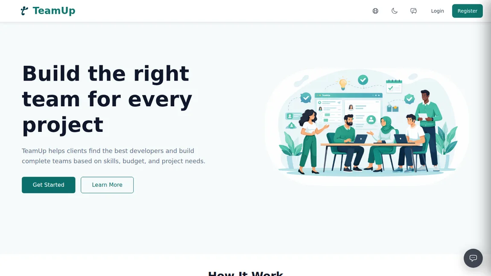

# TeamUP

TeamUP is a graduation project for assembling software teams. It explores how clients find developers, review applications, build a team, and coordinate work after a match.

[Open the public preview](https://team-up-one-pink.vercel.app/)



## What to explore

| Area | Included in the repository |
| --- | --- |
| Hiring and team formation | Client and developer dashboards, job and applicant views, manual team selection, and recommendation screens |
| Team coordination | Team-leader dashboard, project views, notifications, and chat UI |
| Platform | Role-based routes, localized UI, Supabase authentication, and realtime chat code |

The public landing page and skill-quiz screens are a starting point. Some application screens use demo data. The app requires a Supabase URL and client key at startup. Authenticated features also need the matching schema and policies. The optional chatbot needs an n8n webhook.

## Run locally

Use Node.js 22.12+ and npm.

```bash
npm ci
```

Before starting the app, add `.env.local` with values from a development project.

```dotenv
VITE_SUPABASE_URL=https://your-project.supabase.co
VITE_SUPABASE_ANON_KEY=your-public-anon-or-publishable-key
VITE_N8N_CHATBOT_WEBHOOK_URL=
```

The checked-in [SQL migrations](supabase/migrations/) are incremental changes for chat and Realtime. Set up the existing application schema and its policies before using them on a new environment. The [Express prototype](backend/) is separate from the Vite frontend.

```bash
npm run dev
npm run build
npm run lint
```

## Code map

- [`src/routes/`](src/routes/) defines public and role-based routes.
- [`src/pages/`](src/pages/) contains hiring, collaboration, and dashboard screens.
- [`src/features/chat/`](src/features/chat/) contains chat, reactions, and call UI.
- [`src/lib/`](src/lib/) contains Supabase integration.
